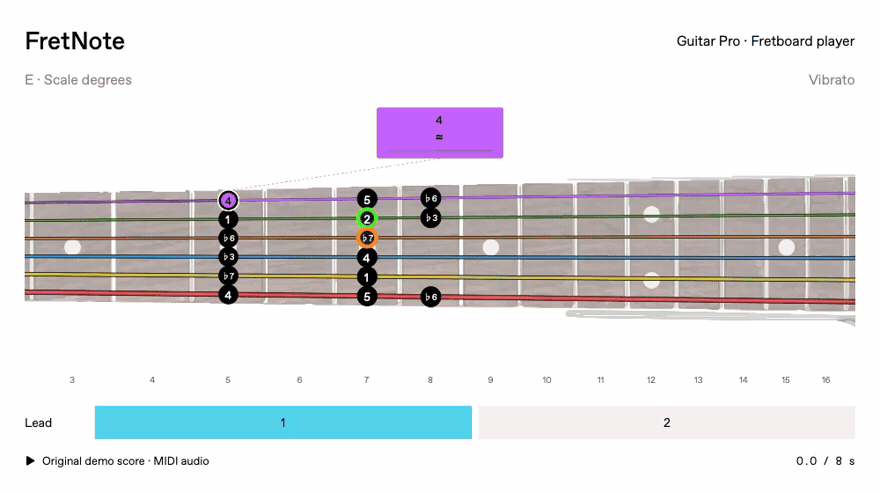
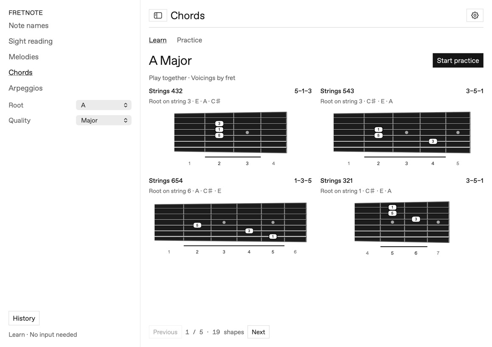
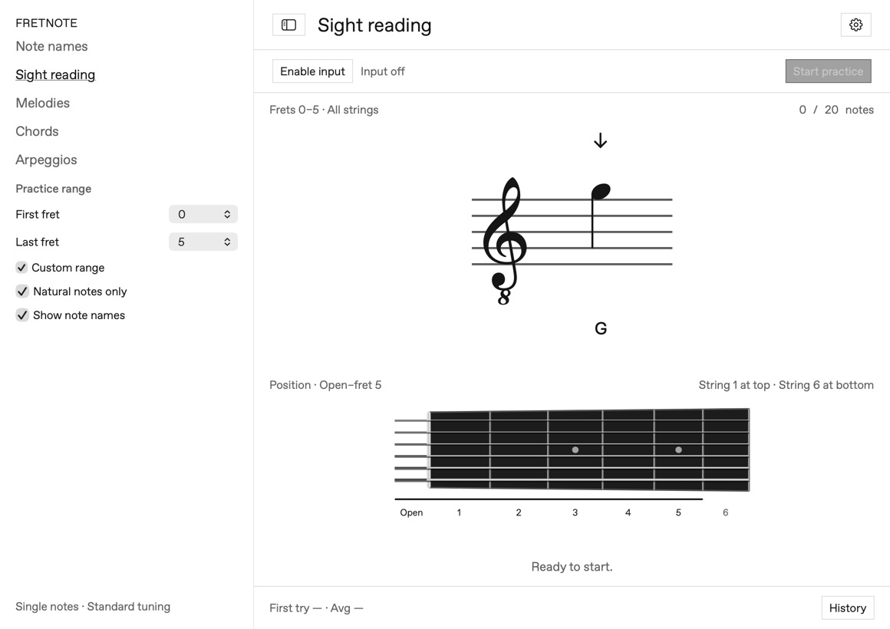

# FretNote

**English** · [简体中文](README.zh-CN.md)

[](https://github.com/lele94218/FretNote/actions/workflows/build.yml)
[](https://github.com/lele94218/FretNote/releases/latest)
[](LICENSE)

Learn the guitar fretboard, practice sight-reading, and follow Guitar Pro scores in a native macOS app. Audio processing stays on your Mac.

**[Download](https://github.com/lele94218/FretNote/releases/latest)** · [Report an issue](https://github.com/lele94218/FretNote/issues)

## Preview



**Endless Rain · solo, bars 5–8.** [Try the demo score](docs/demo/fretnote-demo.gp)

## Features

- **Fretboard & sight-reading practice** — play prompted notes or short melodies through an audio interface or microphone; get pitch feedback and track your learning history.
- **Chords & arpeggios** — browse shapes, then practice three-note triads and seventh-chord shells. Arpeggios check notes in order; chord recognition is experimental.
- **Guitar Pro playback** — import GP3/4/5, GPX or GP files, follow a 21-fret guitar, loop bars and slow down to 25% without changing pitch.
- **Multitrack audio** — guitar, bass and drums with independent mute controls, a bar grid and a synchronized metronome.
- **Expressive fretboard** — animated bends, releases and vibrato, including bends with vibrato. Optional scale-degree labels cover the current position; note names remain the default.
- **Made for Mac** — English / 简体中文, light / dark mode, adjustable text size, and a saved file list that restores on launch.

<details>
<summary>More screenshots</summary>





</details>

## Install

Download the **macOS arm64 ZIP** from [Releases](https://github.com/lele94218/FretNote/releases/latest), unzip it, and move `FretNote.app` to Applications.

- Apple Silicon Mac · macOS 13 or later.
- Builds are ad-hoc signed, not notarized. If macOS blocks launch, follow [Apple’s instructions](https://support.apple.com/102445) after verifying the source, or build locally.
- No Intel release is provided; Intel builds have not been verified.

## Quick start

**Practice:** connect your guitar, select the audio interface and input channel in Settings, then start listening. Use a clean signal and mute unused strings. Choose an exercise and start practicing.

**Follow a score:** open **Fretboard player**, import a Guitar Pro file, choose the guitar row in the bar grid, and press Play. Use **Scale degrees** to overlay the current position’s scale labels.

Pitch detection verifies the sound, not the physical string or fret. Scale names are estimates. Imported scores support standard-tuned, six-string guitars without a capo, up to fret 21; their playback does not grade your performance. Files and learning records stay local.

## Development

Requires macOS and Xcode Command Line Tools with Swift 5.9 or later.

```sh
git clone https://github.com/lele94218/FretNote.git
cd FretNote
swift test
bash scripts/build-app.sh
open ~/Applications/FretNote.app
```

The parser and sound bank are bundled; Node.js is only needed to rebuild the Guitar Pro adapter. See [parser and audio documentation](tools/guitar-pro/README.md), [chord detection validation](docs/chord-detection-validation.md), and [demo export instructions](docs/demo/README.md).

Issues and pull requests are welcome. For audio bugs, include the macOS version, interface, input settings and reproduction steps. Run `swift test` before submitting changes.

## License

[MIT](LICENSE). Bundled components retain their licenses: [alphaTab · MPL-2.0](Sources/FretNoteApp/Resources/alphaTab-LICENSE.txt), [TinySoundFont · MIT](Sources/FretNoteApp/Resources/TinySoundFont-LICENSE.txt), [Sonivox · Apache-2.0](Sources/FretNoteApp/Resources/Sonivox-LICENSE.txt), [Inter · OFL](Sources/FretNoteApp/Resources/Inter-LICENSE.txt), and [Bravura · OFL](Sources/FretNoteApp/Resources/Bravura-LICENSE.txt). Public builds use open-source fonts; locally supplied commercial fonts are excluded from releases.
