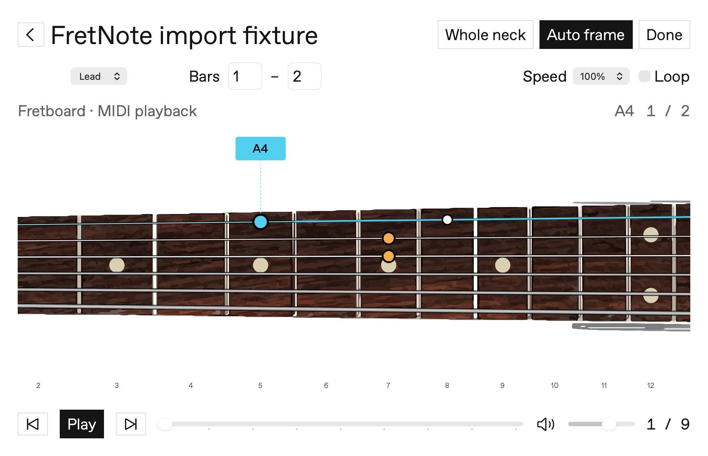
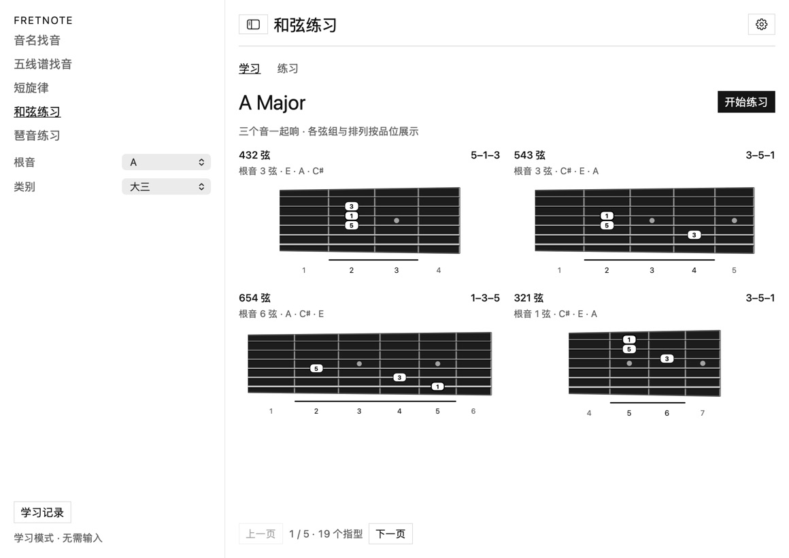
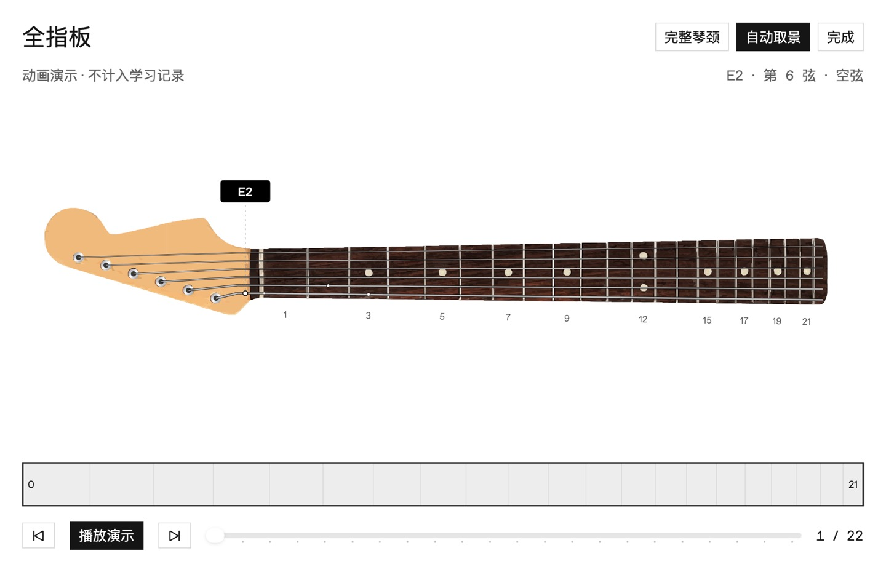
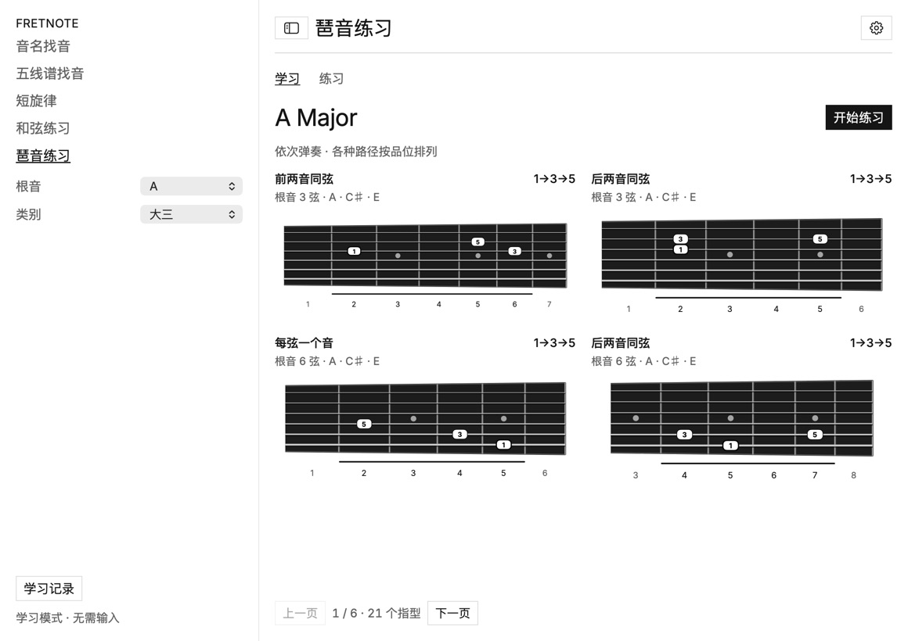
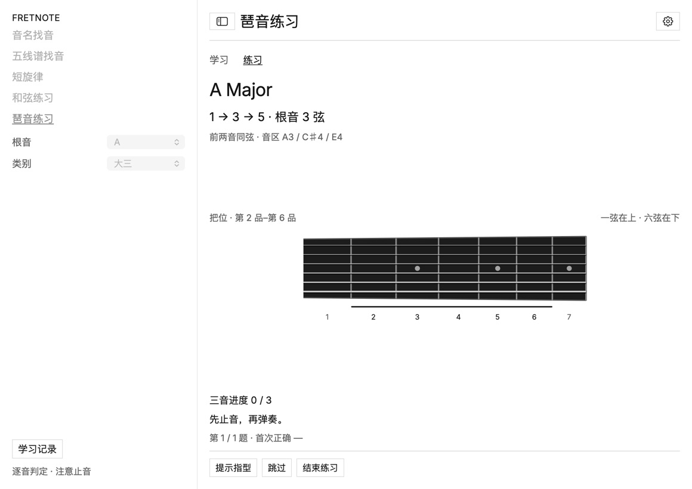
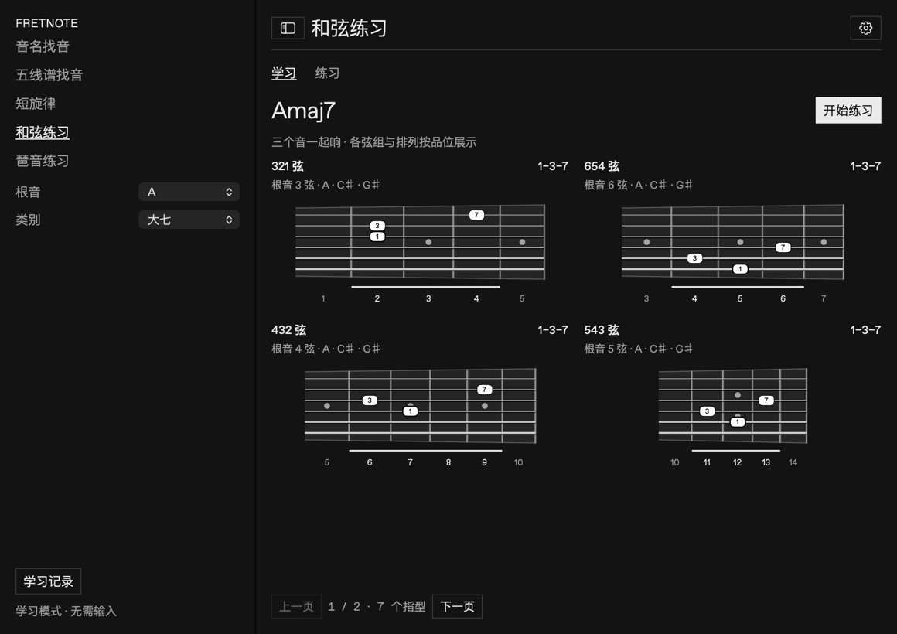
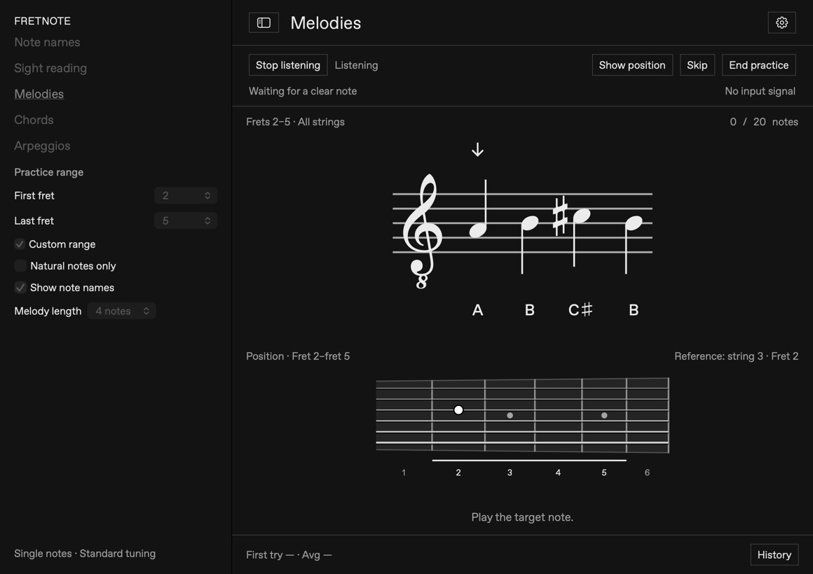
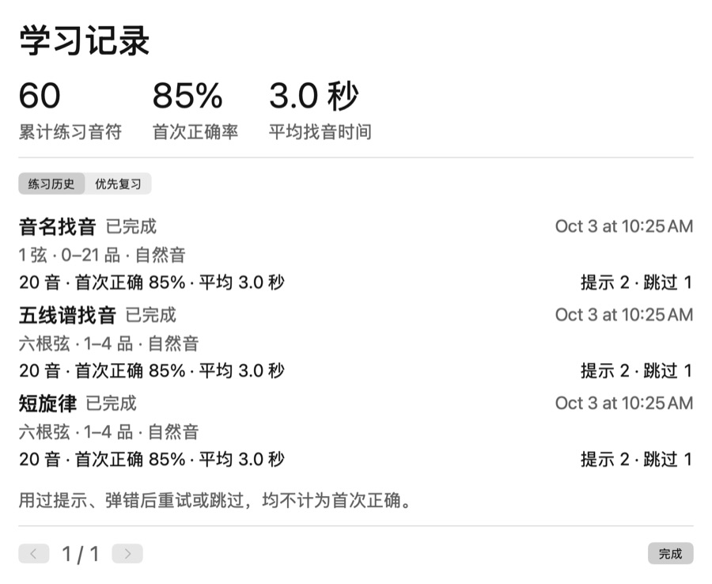

# FretNote

**English** · [简体中文](README.zh-CN.md)

[](https://github.com/lele94218/FretNote/actions/workflows/build.yml)
[](LICENSE)

An offline macOS app for learning the guitar fretboard and reading sheet music, with real-time audio pitch detection.

Connect a guitar through an audio interface, read the note, and play it. FretNote checks the pitch and keeps a local learning history. Built with SwiftUI and Core Audio, with a minimal black-and-white interface.

[Download for macOS](https://github.com/lele94218/FretNote/releases/latest) · [Report an issue](https://github.com/lele94218/FretNote/issues)

The sidebar’s **Fretboard player** opens the full 21-fret instrument and Guitar Pro playback directly. Imported scores appear as closable tabs; open scores and the selected tab are saved locally and restored on relaunch, without reimporting or requiring the original files. The last main navigation selection is restored when it was the player. Closing the last window quits the app. The guitar button in each practice header also opens the instrument. Play the built-in animation demo, step through notes, scrub the timeline, or use Whole neck / Auto frame. The proportional camera widens for position changes and zooms in on nearby notes; the overview strip supports manual positioning. During an active exercise it frames the entire note set once and only marks completed notes and explicitly revealed hints, without exposing future answers. Respects Reduce Motion. Use **Import Guitar Pro** in the idle full-fretboard window to open local GP3/4/5, GPX or GP files. Select a guitar track, bar range, 25–100% speed and looping. MIDI playback follows score timing, rests, repeats, tempo changes and pitch bends using the bundled open-source TinySoundFont synthesizer and Sonivox sound bank. The fretboard follows the audio sample clock; camera cues never delay the music. Playback includes volume control, pitch-preserving slowdown, exact pause/resume and looping. A multi-row track grid shows numbered bars with only the current bar highlighted. Click a supported guitar row/cell to select the track and seek; bass, drums and other tracks play alongside it. Each row has an independent mute/unmute button; muting does not interrupt playback. Track selection uses this grid instead of a dropdown. Long timelines scroll horizontally; large track lists page within the fixed-height panel. An optional metronome shares the audio clock, follows score meter, repeats and tempo changes, and accents each bar’s first beat. Older caches without beat metadata offer an actionable Enable metronome button to locate the original score and upgrade the existing tab. Source files are archived locally; parser upgrades automatically rebuild cached scores while keeping open tabs. Track events are isolated and virtual MIDI channels normalized to prevent dropped notes and silent secondary tracks. Automatic offline analysis estimates a tonal centre and a scale for each four-bar phrase. The scale name is marked Estimated; the Scale diagram switch (off by default) opens a spacious schematic fretboard with large degree circles; the normal instrument keeps note names. Scale diagram circles show degrees (1, ♭3, 5, etc.), with a dot for tones outside the estimated scale. Sparse passages may show Scale undetermined. These pitch-profile estimates are not definitive harmonic analysis and do not reliably follow modulations. All positions needed in the current bar stay visible. Strings, markers and bend guides use Rocksmith colors: strings 6→1 are red, yellow, blue, orange, green and purple. Current notes are solid with a white outer ring, upcoming notes are hollow colored rings, and other bar positions are dimmed. Simultaneous notes are shown together, with bend, slide, hammer/pull-off and tie indicators. Bends show the source/target pitches, ½/full amount, a live pitch meter and release direction outside the strings; the string visibly bends toward the inside of the neck with the sounding pitch and returns on release. The circular finger marker moves with the string at the same fret; the nut and bridge remain fixed. Currently accepts standard-tuned six-string tracks without a capo, up to fret 21. All tracks are mixed for playback; only the selected supported guitar track guides the fretboard. Performance scoring is not yet included. Audio is prepared locally before playback (up to 20 minutes at the selected speed). Parsing stays offline and does not affect learning records. See [parser dependencies and regeneration](tools/guitar-pro/README.md).

## Screenshots



Actual app views rendered with demo data; no personal learning records are shown. Exercise screenshots use a consistent 1160 × 820 pt window and 125% text size. All exercises share the same fretboard proportions and drawing height limit.

### Chord practice · 135




Demo notes run on fixed 1.2-second deadlines. Auto frame starts 0.7 seconds before the next note, preserves all highlights while moving, and settles before that note starts without adding playback time. Nearby notes reuse the current view. Live exercises frame the whole set in advance and keep the camera still while you play.

Whole neck shows the headstock and 21-fret neck with a cropped body shoulder, using photo-traced vector artwork. A larger cyan dot and matching label highlight the current note; orange marks the next note. The active string is cyan, with its sounding length from fret to bridge emphasized. Traced contours are smoothed as vector curves; position markers are exact circles, with a double dot at fret 12. Note markers scale with string spacing; note names stay outside the neck to keep all six strings readable.



[Full fretboard animation · MP4](docs/screenshots/full-fretboard-motion.mp4)

### Arpeggio practice



### Arpeggio practice · Audio input



### Chord practice · 137 · Dark



### Sight-reading · Light


### Melody and position hint · Dark



### Learning history



The main practice screens borrow the text-led navigation, restrained monochrome palette and editorial grid of [SSENSE](https://www.ssense.com/en-us). Native macOS menus, adjustable text, proportional diagrams and a single-window layout remain. Local builds can use user-supplied Favorit SSENSE Inter / Regular, with PingFang SC for Chinese. Public builds bundle OFL-licensed Inter as the fallback; proprietary SSENSE fonts are not included in this repository. Music notation continues to use Bravura.

Choose **Settings → Appearance → Language** to switch between **简体中文** and **English**. The choice is saved and applies immediately to app controls, practice feedback and existing history without resetting the exercise.

## Features

- **Fretboard learning:** choose a root and quality to view a gallery of 135 triads or 137 shells, without connecting a guitar. The current source build also provides ordered arpeggio practice and experimental polyphonic chord practice.

- **Note-name practice:** choose one or more strings. Each question specifies a string; find the named note anywhere from the open string to fret 21. Any playable octave of that note on the requested string is accepted.
- **Sight-reading:** read a note on the staff and find it within a selected position, across all six strings. The fretboard stays visible; hints reveal a reference position.
- **Short melodies:** play 3–5 notes within a fixed position, checked one note at a time for pitch and order.
- **Position practice:** four consecutive frets by default, with an optional custom range, up to fret 21. Optionally practice only natural notes.
- **Learning history:** cumulative accuracy and response time, session history, hints, skips, and prioritized review. Each completed answer is saved automatically.
- **Native macOS UI:** light, dark, and system themes; adjustable text size from 100% to 175%; proportional staff and fretboard rendering. Practice fits in one window; history uses pagination.
- **Offline audio:** processing happens locally in memory. No audio recording, uploads, accounts, or runtime network dependency.

The app interface is currently in **Simplified Chinese**. Documentation is available in both languages.

## Download and install

Download `FretNote-v0.3.1-macOS-arm64.zip` from [Releases](https://github.com/lele94218/FretNote/releases/latest), unzip it, and drag `FretNote.app` into Applications.

- **Release requirements:** Apple Silicon Mac (M series), macOS 13 or later.
- **Intel Macs:** no prebuilt release yet. Building from source may work but has not been verified.
- **Signing:** builds are ad-hoc signed, without Apple Developer ID signing or notarization. macOS may block the first launch. Follow [Apple's guidance](https://support.apple.com/102445) only after verifying the download source, or build from source.

## Chords and arpeggios: learn → practice

This section describes the current source/local development build. The v0.3.1 download still has the earlier single-shape browser.

Choose **和弦练习** (chords) or **琶音练习** (arpeggios), then only a **root and quality**. Learning automatically presents string sets, degree orders, root strings, arpeggio paths and positions as a paginated gallery. There are no separate string-set, inversion or path selectors. Supported qualities are major, minor, augmented and diminished triads (135), plus major, dominant and minor seventh shells (137). Shapes cover frets 1–21 with their complete span; open strings are currently excluded.

Click **开始练习**, or switch **学习 / 练习** at the top. The selected root and quality remain. The app prepares up to 10 distinct sounding voicings, hides the reference positions, and provides hints, skip, next and end controls. The question states degrees, root string, sounding octaves and position range. Mute before each new question. Returning to learning stops capture.

- **Arpeggios:** checks three sounding pitches and octaves in order. A mistake stays on the current note; completing all three counts as one question.
- **Chords:** a separate polyphonic analysis checks coexisting pitches and octaves. A short strum followed by sustained notes is accepted; separated notes are not accumulated. This is **experimental**: synthetic tests pass, but real guitar/interface accuracy and latency have not been validated. Use a clean signal and mute unused strings. Weak fundamentals, distortion and extra octave-doubled notes remain limitations.

Browsing does not affect scores. Completed three-note questions are saved separately by mode and 135/137 family, with first-correct, hint and skip counts. Existing single-note progress is preserved. Incomplete questions do not count. Audio cannot verify physical fingering.

## Getting started

1. Connect your guitar to an audio interface. Use standard tuning: **E2 A2 D3 G3 B3 E4**, from string 6 to string 1, and a clean signal.
2. Open FretNote and select your device and input channel in **Settings → Audio Input** (`设置 → 音频输入`). Microphone input is also supported, though an interface provides a cleaner signal.
3. Click **Start Listening** (`开始监听`) and allow microphone access. macOS requires this permission for audio interfaces too.
4. Play a few isolated notes to check the level and detected pitch, then click **Start Practice** (`开始练习`).
5. Complete a 20-note session, or finish early. Mistakes, hints, and skips increase the priority of those notes in future practice.

The default position is frets 1–4. Selecting fret 5 moves it to frets 5–8. Custom ranges can include open strings. Staff notation follows guitar convention: **written one octave above sounding pitch**. The small 8 beneath the treble clef indicates this transposition.

Single-note exercise shortcuts:

| Shortcut | Action |
| --- | --- |
| `⌘Return` | Start / end practice |
| `⇧⌘H` | Show position hint |
| `⌘→` | Skip note |
| `⇧⌘I` | Start / stop listening |
| `⌘,` | Settings |
| `⌃⌘S` | Toggle sidebar |

## Detection limits

- Existing note-name, staff and melody exercises use single-note detection. The current source build adds experimental chord detection as described above. Rhythm, bends and slides are not evaluated.
- Staff and melody modes require the correct sounding pitch and octave. Note-name mode accepts matching pitch classes within the requested string's playable range.
- Audio cannot reliably determine the physical string or fret when multiple positions produce the same pitch. Follow the displayed position yourself.
- Detection requires a stable pitch, allowing approximately ±40 cents. Unclear input and noise do not count as wrong answers.
- Mute between repeated notes when needed. Sustained notes do not repeatedly advance the exercise.
- Disable distortion, reverb, and delay, and mute unused strings. Harmonics and overlapping notes can cause errors.
- The default noise gate is −45 dBFS. Stop listening before adjusting it. Reduce interface gain if the input clips; refresh devices and restart listening after device or sample-rate changes.

Automated tests use synthetic signals. Accuracy has not been benchmarked against a representative set of real guitar recordings.

## Local data

Learning records are stored at:

```text
~/Library/Application Support/FretNote/progress.json
```

Sessions record their date, mode, string or fret range, natural-note setting, answer count, first-attempt accuracy, average response time, hints, and skips. Completed answers survive an early stop or app exit. Empty sessions are omitted.

Older aggregate statistics are preserved, but historical session details cannot be reconstructed. Proficiency is currently shared across practice modes and keyed by string and fret. Review uses weighted sampling, so notes that are not yet due may also appear. Unreadable records are preserved rather than overwritten.

## Build from source

Requires macOS 13+ and a Swift 5.9+ toolchain (Xcode / Command Line Tools). Guitar Pro import bundles alphaTab (MPL-2.0); no Node or Python installation is needed. The bundled Bravura notation font works offline without system installation.

```bash
git clone https://github.com/lele94218/FretNote.git
cd FretNote
swift test
bash scripts/build-app.sh
open "$HOME/Applications/FretNote.app"
```

The script builds for the host architecture and installs into `~/Applications/FretNote.app`. It closes a running copy before updating. Intermediate app bundles are created under hidden `.build` storage and removed automatically; the old `dist/FretNote.app` is removed after successful installation to avoid duplicate app entries. Learning data stays in Application Support.

Use the packaged `.app` for audio testing so macOS receives the correct application identity and microphone permission description. Re-signing may prompt for permission again. Open `Package.swift` in Xcode to edit the project. GitHub Actions runs tests and uploads an app ZIP.

Optional UI snapshots (briefly opens test windows; does not access audio):

```bash
FRETNOTE_SNAPSHOT_DIR=/tmp/fretnote-preview swift test --filter testRender
```

## Project structure

```text
Sources/FretNoteCore/   Pitch detection, note gating, fretboard mapping, exercises
Sources/FretNoteApp/    SwiftUI, notation, Core Audio input, local learning records
Tests/                 Synthetic audio and practice-state tests
Resources/             App metadata and icon source
scripts/               App packaging and reproducible icon generation
```

Audio pipeline: Core Audio device enumeration → AVAudioEngine input tap → selected mono channel → background downsampling → YIN pitch estimation → stable note events → practice state machine.

Notation uses [Steinberg Bravura](https://github.com/steinbergmedia/bravura) and its SMuFL metadata. Noteheads, clefs, and accidentals use font outlines, with stems aligned to the provided anchors.

## Contributing

Issues and pull requests are welcome. Run `swift test` before submitting changes. For audio issues, include your macOS version, interface, input settings, and reproduction steps. Do not commit personal learning records, credentials, or recordings you do not have permission to share.

Future directions include real-guitar regression samples, separate sight-reading proficiency, rhythm exercises, and expanded notation support.

## License

Inter is distributed under the [SIL Open Font License 1.1](Sources/FretNoteApp/Resources/Inter-LICENSE.txt). Locally supplied commercial fonts retain their original terms and must not be included in public packages.

Project code is released under the [MIT License](LICENSE). The bundled Bravura font and associated resources retain their upstream license; see [Bravura-LICENSE.txt](Sources/FretNoteApp/Resources/Bravura-LICENSE.txt).

Guitar Pro parsing uses [alphaTab 1.8.4](https://alphatab.net/) under its [MPL-2.0 license](Sources/FretNoteApp/Resources/alphaTab-LICENSE.txt).

MIDI synthesis uses [TinySoundFont](https://github.com/schellingb/TinySoundFont) ([MIT](Sources/FretNoteApp/Resources/TinySoundFont-LICENSE.txt)) and the alphaTab-distributed Sonivox sound bank ([Apache-2.0](Sources/FretNoteApp/Resources/Sonivox-LICENSE.txt), [notice](Sources/FretNoteApp/Resources/Sonivox-NOTICE.txt)).
